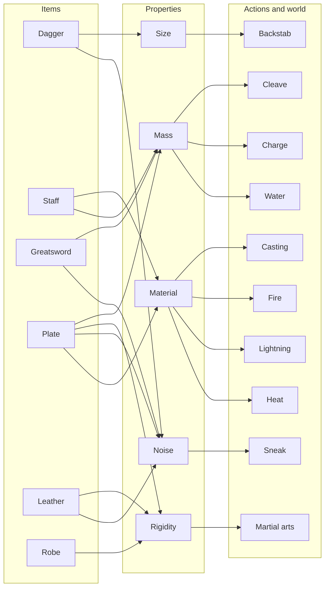

# Loadout properties: what your gear lets you do

[Design index](../SYSTEMS_ROADMAP.md) · [Equipment](equipment.md) · [Techniques](techniques.md) · [Combat exploration](combat-exploration.md)

Proposed design, not implemented. It expands [Equipment changes expression](equipment.md#equipment-changes-expression)
into concrete rules. The numbers and lists here are starting points for a prototype, not settled balance.

## The idea

A loadout is not a stat bundle. Each item has a few **physical properties**, and every action and effect
reads those properties. Each property makes some things harder and others better. Nobody writes a rule
saying plate is good for X. Plate is heavy, so it is good at whatever being heavy helps with.

That gives three rules for the design:

- **No combo list.** Nothing says "monk = robe + staff". A robe and a staff simply permit martial arts and
  magic, so a monk falls out of the rules, and so do builds nobody planned.
- **Every property cuts both ways.** If a property only helps, it is a number, not a property.
- **The world reads the same properties.** Heat, water, and creature traits push on gear just as actions
  do, so what to wear depends on where you are going.

## Properties

Start with the first three. Add the rest only when an action needs them.

| Property | Values | Makes harder | Makes better |
| --- | --- | --- | --- |
| **Mass** | light / medium / heavy | Sneaking, dodging, swimming (heavy sinks in deep water), long travel in heat | Charges and bashes, resisting knockback, cleaving with a heavy weapon |
| **Noise** | quiet / normal / loud | Sneaking, ambushes, avoiding notice | Drawing enemies onto yourself to protect someone, scaring off weak creatures |
| **Material** | cloth, leather, wood, metal | Metal: fire heats it and burns you, lightning arcs through it | Metal holds inscribed wards; wood carries channeled magic well |
| **Rigidity** (later) | flexible / stiff | Martial arts, acrobatics, fine movement | Blades glance off; only blunt force and piercing get through |
| **Size** (later) | small / large | A small weapon has little reach or force | Concealable; works close and quiet; suits backstabs |

A loadout's value for a property is mostly its loudest, heaviest, or stiffest piece. One plate gauntlet
on a robe makes you somewhat louder, not fully plated.

## Items

Illustrative values, one example of each family:

| Item | Mass | Noise | Material | Rigidity | Size | Intended use |
| --- | --- | --- | --- | --- | --- | --- |
| Dagger | light | quiet | metal | — | small | Quiet kills from hiding |
| Staff | medium | normal | wood | — | large | Magic focus **or** a martial weapon |
| Spear | medium | normal | wood + metal | — | large | Reach and piercing |
| Greatsword | heavy | loud | metal | — | large | Straight fights, several enemies at once |
| Robe | light | quiet | cloth | flexible | — | Freedom of movement and casting |
| Leather | light | quiet | leather | flexible | — | Some protection without giving up stealth |
| Plate | heavy | loud | metal | stiff | — | Maximum protection and mass |

## What reads each property

These are the rules. Builds come from them, not from item lists.

| Action or effect | Reads | Rule |
| --- | --- | --- |
| **Basic strike** | weapon | Always available, never costs Focus. Every weapon can win by beating an enemy down. |
| **Sneak** | noise, mass | Only with a quiet, not-heavy loadout. Loud gear cannot sneak at all. |
| **Backstab** | size, sneaking, facing | A small weapon, while sneaking, from behind an unaware creature: a large hit. |
| **Martial arts** | rigidity, weapon | Staff or empty hands, flexible armor: sweeps, trips, parries. |
| **Cleave** | weapon mass | A heavy weapon hits every adjacent enemy. |
| **Charge** | mass | Moving into an enemy hits harder the heavier you are; heavy targets resist being moved. |
| **Casting** | material | Wood and cloth carry magic freely; metal resists channeling unless warded. |
| **Ward inscription** | material | Metal holds wards well; cloth holds them poorly. |
| **Fire** | material | Burns cloth; heats metal and hurts its wearer over a few turns. |
| **Lightning** (later) | material | Arcs to and through metal. |

### Backstab and facing

A backstab is about **position**, not a Focus purchase. Creatures need a facing: the way they last moved,
or toward you once they have noticed you. An aware creature turns to face you, so you can only get behind
one that is wandering, feeding, or busy with something else. Getting there quietly is the hard part, which
makes a landed backstab the fastest kill in the game and a failed approach a straight fight with a weak
weapon.

### The big weapon

It needs its own verb, not just bigger numbers. **Cleave** is the first candidate: one swing hits every
adjacent enemy. Being surrounded becomes the greatsword's best position, the opposite of the dagger's
isolated target. **Knockback** (pushing into walls and water) and **stagger** (the enemy loses a turn) are
alternatives or later upgrades. The trade-off: no setup and reliable in a straight fight, but loud, unable
to sneak, and slower to kill than a landed backstab.

## Magic and materials

Magic interacts with materials through the same properties. There is no special rule against casting in
armor:

- A **fire mage in plate** burns themselves. Fire mages want cloth.
- A **warder in plate** becomes a fortress, because metal holds wards.
- A **force caster in plate** can put their mass behind the spell.
- A **staff** is wood: a better magic focus than a metal sword, and also a martial weapon.

These follow the existing method-based magic direction ([disciplines](disciplines.md)): lawful
interactions with the world, not a mana bar with flavor text.

## The world pushes back

Creatures and places read the same properties:

| Situation | Effect on gear |
| --- | --- |
| Desert | Heavy and metal gear wears you down in the heat |
| Tundra | Metal is cold; cloth alone is not enough |
| Deep water or swamp | Heavy gear sinks; plate can drown you |
| Fire-breathing creature | Metal armor becomes a liability |
| Clawed or biting creature | Rigid armor shines |
| Creature with keen hearing | Even normal noise gives you away |

Creature traits already vary by region ([ecology](ecology.md)), so this ties loadout choices to the
ecology.

## How builds fall out

None of these is a class or a recipe. They are what the rules permit:

| Character | Loadout | Why it works |
| --- | --- | --- |
| Thief | dagger + leather | Quiet and light, so it can sneak and backstab |
| Juggernaut | greatsword + plate (+ wards) | Heavy and stiff: cleaves, charges, can't be moved, holds wards |
| Monk | staff + robe | Flexible armor and a staff permit martial arts |
| Fire mage | staff + robe | Wood and cloth carry fire magic without burning the caster |
| Subtle swordmage (Gandalf) | sword + light armor | Quiet enough to be subtle, with magic on top |
| Battlemage | spear + plate + wards | Metal holds wards, the spear keeps reach; gives up stealth and fire |

A test for the design: someone should find a loadout this table does not list that works for a reason
the rules explain.

## Growth

The loadout decides what you **can** do. What you actually do decides what you become
([learning](learning.md)). A staff wielder who keeps fighting with it drifts toward martial arts; one who
keeps channeling drifts toward magic. Upgrades follow purpose: each item's improvements make it better at
what it is for, such as a quieter dagger or a staff that holds stronger enchantments, not generically
bigger numbers.

## First playable slice

Small enough to test the feel before adding more:

1. A free basic strike is always available, so every weapon can beat down.
2. Creatures have facing.
3. Properties: mass, noise, material.
4. Items: dagger, staff, greatsword, leather, robe, plate.
5. Sneak checks noise and mass. Backstab checks a small weapon, sneaking, and position behind an unaware
   creature.
6. The greatsword cleaves.
7. Fire burns cloth and heats metal.
8. A trial with a few wandering creatures, played three ways: dagger and leather, greatsword and plate,
   staff and robe.

The existing [permutation and property tests](combat-exploration.md) extend to check the trade-offs:
every weapon can kill the sentinel by beating it down, a landed backstab is the fastest kill, and the
greatsword is the most reliable in a straight fight.

## Open questions

- Cleave, knockback, or stagger as the greatsword's verb?
- How strongly does metal resist channeling: a cost, a weaker effect, or only for some magic?
- Martial arts verbs: which of sweep, trip, and parry come first?
- Mixed loadouts: does one heavy piece override everything, or is it graded?
- How visible are facing and noise on screen, so a failed sneak feels fair?
