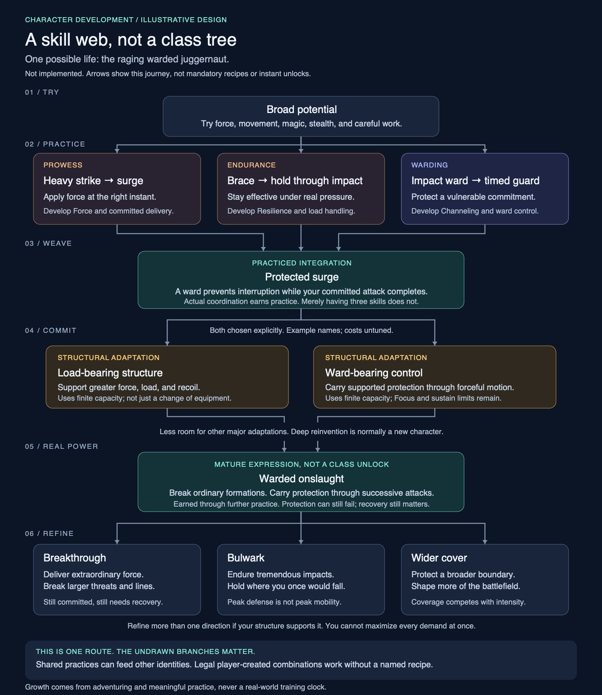

# An example skill web

[Design index](../SYSTEMS_ROADMAP.md) · [Disciplines](disciplines.md) · [Character development](character.md)

**Illustrative design, not implemented gameplay or a finalized unlock catalog.**

Here is what a small part of the "skill tree" could look like. It follows one character becoming a
**raging warded juggernaut**: physical presence and supernatural protection developing together.



[Open the scalable diagram](images/skill-web-example.svg).

## How to read it

- **Arrows record one possible journey**, not mandatory prerequisites or automatic unlocks.
- **Practice develops capability.** No generic skill-point purchases, offline training, or mastery from
  repeating solved harmless tasks.
- **Weaves are interactions**, not class unlocks. The ward actually protects the vulnerable part of a
  physical action; collecting the discipline names is not enough.
- **Commitments change the character.** Relevant experience makes adaptations available; the player sees
  their costs and consequences before accepting. Major adaptations consume finite structural capacity.
- **Refinement makes you genuinely stronger**, while competing demands still prevent maximum force,
  maximum mobility, and maximum protection all at once.
- Names such as *Load-bearing structure*, *Ward-bearing control*, and *Warded onslaught* are examples for
  this picture. Their exact requirements, structural costs, and numbers are not specified yet.

The picture compresses a long journey. Each arrow can contain many useful intermediate improvements.
It does not mean one successful action awards the next node, or that acquiring an adaptation grants
instant mastery of everything below it.

## Walk through this character's life

| Stage | What you actually do | What develops |
| --- | --- | --- |
| Try | Use a heavy weapon, brace against real impacts, and experiment with a modest impact ward | Early Prowess, Endurance, and Warding; broad potential remains open |
| Practice | Learn when to commit a surge, when to brace, and how to time protection | Force, Resilience, and relevant Channeling, plus proficiency in those actions |
| Weave | Complete a forceful action while a ward prevents a real interruption | **Protected surge:** practiced coordination with an actual benefit |
| Commit | Accept earned adaptations after seeing their lasting costs | Support heavier physical commitments and maintain supported protection through movement |
| Become powerful | Carry that coordination through successive demanding encounters | **Warded onslaught:** a fluent, devastating expression of the same practiced structure |
| Refine | Face greater demands within this identity | Greater breakthrough, endurance, or coverage, not just a cosmetic rank or tiny damage bonus |

The two adaptation examples in the diagram describe this character's chosen direction. They are not
universal prerequisites for every protected physical action. Both can coexist in this illustrative
character, but their final costs must leave meaningful opportunity costs elsewhere.

### An example breakthrough preview

```text
AVAILABLE DEVELOPMENT: WARD-BEARING CONTROL

Evidence
  Your impact ward has protected demanding physical commitments.
  You have practiced maintaining protection while moving under threat.

Would enable
  Greater coordination between forceful movement and a supported ward.
  Practice toward longer protected sequences, not automatic mastery.

Commitment
  Uses lasting structural capacity.
  Leaves less room for other major adaptations.
  No routine respec. You can defer this choice.

Still limited by
  Focus, sustain load, the ward's protection rule, and its break conditions.

[Compare developments]  [Defer]  [Review and confirm commitment]
```

This is a conceptual preview, not a shippable UI specification. The real screen must show **exact capacity
used and remaining, benefits, and any incompatibilities** before confirmation. Do not make players commit
using only vague text such as "leaves less room."

### What the three late branches mean

| Refinement | Real power gained | What it does not erase |
| --- | --- | --- |
| Breakthrough | Smash through ordinary opposition; deliver much greater committed force against larger threats | Positioning, commitment, and recovery |
| Bulwark | Remain effective through impacts that once would have stopped the character | Finite protection, sustain load, and the mobility cost of maximum defense |
| Wider cover | Protect a broader supported boundary instead of only a narrow exposure | Coverage competes with concentration and occupies more capacity |

These are refinement directions, not an obligatory three-way class choice. A character may develop more
than one within its structure. Advancement should still make an expert strictly more capable than their
earlier self. An apex can test that power without ordinary enemies secretly scaling up to match it.

## Where the same roots can go instead

These are more illustrations, not the complete set of legal builds:

| Practiced connections | Another possible direction | Distinctive commitment |
| --- | --- | --- |
| Prowess + Ranged arms | Heavy thrown-spear specialist | Impulse and trajectory rather than maximum sustained protection |
| Acrobatics + Ranged arms | Moving shuriken fighter, with no magic required | Landing space, movement timing, and precise delivery |
| Evocation + Warding | Close-range magic blaster | Concentrated channeling and protected entry |
| Ranged arms + Precision + Binding | Returning shuriken specialist | Distributed control, ammunition recovery, and maintained links |
| Evocation + Binding | Area-of-effect frost mage | Field placement, anchors, and sustained area control |
| Stealthcraft + Precision + Alteration + Veiling | Poison-stealth mage | Valid carriers, subtle delivery, and delayed consequences |

The juggernaut might learn a modest adjacent trick. It cannot freely exchange its mature structure for
deep distributed control or subtle expression. A radically different life is normally a new character.

## The important missing branch: yours

```text
Known delivery + compatible effect + supported relationship
                             |
              Core checks structure and costs
                             |
             A legal technique nobody named yet
                             |
         Prepare it -> use it meaningfully -> refine it
```

Players are not limited to clicking the nodes in this picture. In the proposed composition workspace,
they can combine supported components, inspect requirements and costs, and save a legal structure.
An unexpected combination must work, earn relevant practice, and persist under the same rules as the
authored examples. Knowing its structure does not grant execution mastery or bypass lasting commitments.

See [technique composition](techniques.md), [weaving](weaving.md), and the planned
[composition workspace](interface.md#composition-workspace) for those rules.
